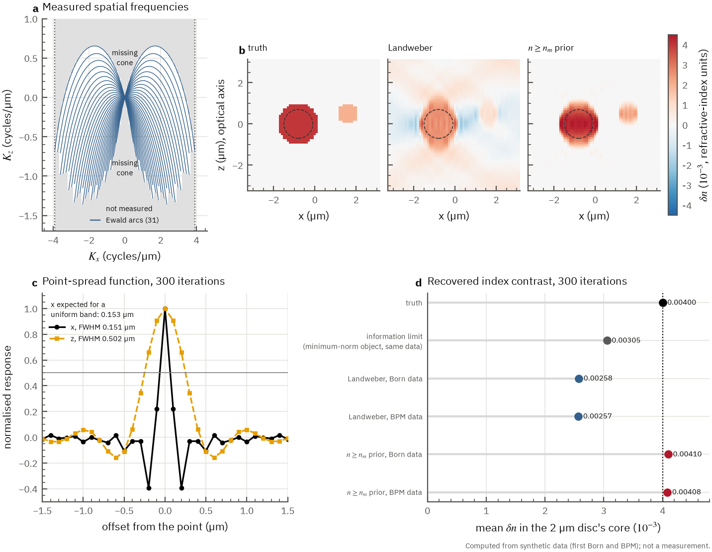

# QoraHolo

[](https://github.com/NaNIsaac/QoraHolo/actions/workflows/ci.yml) [](https://github.com/NaNIsaac/QoraHolo/blob/main/LICENSE)

**Holotomography reconstruction in C++20 and CUDA: off-axis holograms in, a 3D refractive-index volume out.**

Holotomography (optical diffraction tomography, ODT) records off-axis holograms of a
transparent sample under many illumination angles and reconstructs its 3D refractive index.
QoraHolo implements the standard pipeline: field retrieval from the hologram sideband,
least-squares phase unwrapping, the Rytov approximation, Ewald-sphere mapping by the Fourier
diffraction theorem, and two missing-cone solvers: Gerchberg-Papoulis with non-negativity and
FISTA with a total-variation term. For samples where the first-order models break down, a
multi-slice beam propagation model (BPM) and its gradient-based inversion account for multiple
forward scattering. Every stage has a CPU implementation (pocketfft, OpenMP)
and a CUDA implementation (cuFFT, custom kernels); on the benchmark volumes the two differ by
4e-6 to 4e-5 relative. `Pipeline` keeps plans and buffers alive between calls and on CUDA
runs from holograms to index with one upload and one download. A sphere phantom with an
analytic forward model and a hologram synthesiser make the whole chain testable against a
known answer. Python bindings take and return numpy arrays.


A synthetic cell (body n = 1.360, nucleus 1.375, two vesicles 1.390, medium 1.337),
49 illuminations at NA 0.9, 512² holograms with Gaussian noise (σ = 1% of the mean
intensity), fields cropped to 256²,
reconstructed into a 256³ volume. Illumination angles are estimated from the background
holograms, not taken from the simulation (largest error 4.3e-6 cycles/µm). Mean index in
the nucleus: 1.3683 from Rytov ODT, 1.3757 after 20 Gerchberg-Papoulis iterations (true
1.3750), 1.3762 after 20 FISTA-TV iterations with 10 dual steps each. RMSE against the
phantom over the whole volume: 2.37e-3, 9.25e-4 and 7.69e-4. The x-z slices show the
missing-cone elongation along z, how much of it the non-negativity constraint removes, and
that TV removes most of the rest and the ringing, with overshoot at the top and bottom of the
nucleus. Field extraction to GP took 0.23 s on CUDA and 1.80 s on CPU through the per-call
functions; the TV reconstruction took 0.42 s and 10.3 s. The TV weight (1e-2, the default)
was picked from a sweep on this phantom, so the TV numbers are tuned to it. Script:
`examples/readme_figure.py`.

## Start with the evidence

- **What is reconstructed:** [synthetic hologram-to-volume example](docs/reconstruction.png) · [script](examples/readme_figure.py), including phantom parameters and output comparisons below.
- **What the tests establish:** [research findings](docs/FINDINGS.md) — independent forward-model comparisons and where priors are necessary.
- **How fast it runs:** [benchmark](#benchmark) — consult its hardware, workload and accuracy conditions.
- **What remains unsupported:** [scope and limitations](#what-this-does-not-do).

The representative reconstruction is **synthetic**; the TV regularization weight was selected on this phantom. It is not a measured-sample validation.

## Findings

- [F3: The sphere forward models agree with independent codes; Rytov's error grows with Δn](docs/FINDINGS.md#f3-the-sphere-forward-models-agree-with-independent-codes-rytovs-error-grows-with-δn)
- [F5: The prior n ≥ n_m recovers the core index that the data do not carry, within 5 % up to moderate noise](docs/FINDINGS.md#f5-the-prior-n--n_m-recovers-the-core-index-that-the-data-do-not-carry-within-5--up-to-moderate-noise)
- [F4: Without a prior, most of the missing index is information the data do not carry](docs/FINDINGS.md#f4-without-a-prior-most-of-the-missing-index-is-information-the-data-do-not-carry)

[All findings →](docs/FINDINGS.md)

## Quick start

Requires CMake 3.28+, Ninja (the presets use it), a C++20 compiler (gcc 13+, MSVC 2022),
and for the GPU backend the CUDA Toolkit 12.8 or newer.

<!-- test unix -->
```bash
cmake --preset cpu-release          # or cuda-release
cmake --build --preset cpu-release
ctest --preset cpu-release
```

```cpp
#include "qoraholo/qoraholo.hpp"
using namespace qoraholo;

const Geometry geom{0.532f, 1.337f, 1.2f, 0.2f};  // wavelength, n_medium, NA, pixel (um)
const auto illum = circular_scan(49, 0.9f, geom);   // or your measured illumination list
// ratio: (49, n, n) field ratios u / u_background, e.g. from extract_fields + field_ratio
OdtOptions opt;
opt.iterations = 20;  // Gerchberg-Papoulis; opt.solver = Solver::tv for FISTA-TV
opt.backend = cuda_available() ? Backend::cuda : Backend::cpu;
const OdtResult r = reconstruct(rytov(ratio, opt.backend), illum, geom, opt);
// r.ri: (n, n, n) refractive index, centre-origin
```

For repeated reconstructions with the same geometry (a time series), `Pipeline` allocates
once and keeps the background fields:

```cpp
PipelineOptions po;
po.count = 49;
po.hologram_size = 512;
po.field.center = {141.0f, 141.0f};  // reference carrier, pixels from DC
po.field.radius = 65.0f;
po.field.output_size = 256;
po.illuminations = illum;
po.geometry = geom;                  // field pixel
po.odt = opt;
Pipeline p(po);
p.set_background(backgrounds);       // (49, 512, 512)
for (const auto& frame : frames) {
  std::ranges::copy(frame.data, p.input().begin());  // or write into input() directly
  p.process();
  use(p.output());                   // (256, 256, 256), valid until the next process()
}
```

`examples/quickstart.cpp` is this snippet with a synthetic bead as input. It prints
`n at the centre 1.3639 (true 1.3600), k-space filled 19.0%` on both backends.

Python (3.12+), built with scikit-build-core and nanobind. The release workflow builds CPU-only
wheels (Linux x86_64, Windows AMD64, macOS arm64; one abi3 wheel per platform). There are no
CUDA wheels: they would have to bundle or pin a CUDA runtime and cuFFT for every driver range,
so the GPU backend is built from source. The macOS wheel has no OpenMP (Apple clang does not
ship it), so its element-wise loops run on one thread; the FFTs still use pocketfft's threads.

Build the wheel from a clone, install it into a virtual environment and import it. CPU only:

<!-- test unix -->
```bash
uv build --wheel
uv venv
uv pip install dist/*.whl
.venv/bin/python -c "import qoraholo"
```

<!-- test windows -->
```powershell
uv build --wheel
uv venv
uv pip install (Get-ChildItem dist/*.whl).FullName
.venv\Scripts\python -c "import qoraholo"
```

With the CUDA backend, build the wheel with:

```bash
CMAKE_ARGS="-DQORAHOLO_CUDA=ON" uv build --wheel
```

On Windows the CUDA build loads cuFFT from `%CUDA_PATH%\bin`.

```python
import qoraholo as qh

geom = qh.Geometry(wavelength=0.532, n_medium=1.337, na=1.2, pixel=0.11)
opts = dict(center=(141, 141), radius=65, output_size=256)  # carrier, crop
fields = qh.field_ratio(
    qh.extract_fields(holograms, **opts),  # (49, 512, 512) float
    qh.extract_fields(backgrounds, **opts),
)
ri = qh.reconstruct(qh.rytov(fields), illuminations, geom, iterations=20, backend="cuda")

p = qh.Pipeline(
    49, 512, illuminations=illuminations, geometry=geom, iterations=20, backend="cuda", **opts
)
p.set_background(backgrounds)
ri = p.run(holograms)  # p.timings: milliseconds per stage of the last run
```

## Multiple scattering: beam propagation

Born and Rytov assume each point of the sample sees the incident wave. In a large or
high-contrast object, or in several objects stacked along the optical axis, the wave reaching
the lower part has already been refracted by the upper part, and first-order reconstructions
are biased. `bpm_forward` propagates the field slice by slice instead (a thin phase screen
per voxel, then angular-spectrum propagation in the medium), and `bpm_reconstruct` fits the
index to the measured field ratios by gradient descent on that model, starting from a Rytov
reconstruction (learning tomography, Kamilov et al. 2015, 2016; Lim et al. 2019 compare it
with Rytov ODT on multiple-scattering samples).


128³ voxels of 0.15 µm, 49 illuminations at NA 0.9, true index 1.400 in a medium of 1.337,
no noise. The data do not come from the discretisation that is inverted:

- **bead**: one sphere of radius 4 µm, fields from the exact partial-wave solution of the
  scalar Helmholtz equation (`forward_fields(..., model="exact")`);
- **stack**: three spheres of radius 2 µm at z = −4.5, 0 and 4.5 µm, fields from the BPM on a
  grid twice as fine in x, y and z (0.075 µm), cut to the coarse grid in Fourier space. This
  tests the solver and the discretisation, not the BPM approximation itself, since the data
  come from the same physics model.

| bead (exact data) | RMSE | mean n inside 0.6 R | CUDA (s) | CPU (s) |
|---|---:|---:|---:|---:|
| Rytov ODT | 6.87e-3 | 1.3882 | 0.01 | 0.02 |
| Rytov + 20 GP | 5.36e-3 | 1.4016 | 0.01 | 0.19 |
| Rytov + 20 FISTA-TV | 4.93e-3 | 1.4009 | 0.05 | 1.93 |
| BPM, 30 iterations from Rytov + GP | 2.50e-3 | 1.4019 | 0.52 | 23.7 |
| BPM + TV (weight 3e-2) | 2.39e-3 | 1.4018 | 0.59 | 25.5 |
| BPM with the plain phase screen | 5.06e-3 | 1.4279 | 0.52 | 23.4 |

| stack (finer-grid BPM data) | RMSE | mean n inside 0.6 R | CUDA (s) | CPU (s) |
|---|---:|---:|---:|---:|
| Rytov ODT | 4.94e-3 | 1.3807 | 0.01 | 0.02 |
| Rytov + 20 GP | 4.27e-3 | 1.3964 | 0.01 | 0.23 |
| Rytov + 20 FISTA-TV | 3.89e-3 | 1.3990 | 0.05 | 1.86 |
| BPM, 30 iterations from Rytov + GP | 2.00e-3 | 1.4031 | 0.53 | 23.7 |
| BPM + TV (weight 3e-2) | 1.95e-3 | 1.4032 | 0.58 | 26.0 |
| BPM with the plain phase screen | 3.64e-3 | 1.4268 | 0.52 | 24.8 |

Plain Rytov underestimates both objects (by 19% and 31% of the contrast). Gerchberg-Papoulis
and TV bring the mean back but leave the shape wrong: the bead is flattened and its rim too
bright, and in the stack the lower spheres are distorted by the shadow of the ones above. The
BPM inversion halves the RMSE against the best first-order result and recovers three separate
spheres. It still has the missing-cone elongation along z, since the measured angles are the
same. BPM times exclude the Rytov + GP start; the CPU and CUDA results agree to the printed
digits. The TV weight was picked from a coarse sweep on the bead (1e-4 to 1e-1 at 64³) and
helps little here. Script: `examples/bpm_figure.py`.

The last row of each table is the usual split-step BPM. Its weak-object limit lacks the
obliquity factor of the scattered wave (see "Beam propagation" below), so tilted
illuminations are under-modelled and the inversion overshoots to 1.428. In the stack case the
data were made with the obliquity weight, so that row also carries a model mismatch by
construction; the bead row does not.

```python
ry = qh.rytov(fields)  # field ratios u / u_background
start = qh.reconstruct(ry, illum, geom, iterations=20)  # Rytov + GP
ri, loss = qh.bpm_reconstruct(
    fields, illum, geom, start, iterations=30, backend="cuda", return_loss=True
)
```

## First Born operator in 2D

`qoraholo.born2d.Born2D` is the first Born forward model for a 2D (x, z) object, written in
NumPy as an explicit linear operator with its exact adjoint, for tests and small inverse
problems. It is not used by the C++ reconstruction. The object is the scattering potential
k0²(n² − n_m²) on a centre-origin (nz, n) grid. The output is the scattered field ratio
u_s/u_in at z = 0, band-limited to the detection NA, the same convention as `bpm_forward`.
Sums are evaluated at the exact Ewald-arc frequencies, with no interpolation onto a grid.

```python
from qoraholo.born2d import Born2D, potential

# illuminations: fx of each plane wave, cycles/µm
model = Born2D(0.532, n_medium=1.337, na=1.2, pixel=0.1, n=64, nz=64, illuminations=(-0.5, 0, 0.5))
fields = model.forward(potential(ri, 1.337, 0.532))  # (3, 64)
back = model.adjoint(fields)  # (64, 64)
```

The first Born approximation holds while the phase the object adds is small,
|δn|·k0·L ≪ 1 (`born_phase`). `python/tests/test_born2d.py` checks three things:
- the adjoint, to 1e-12;
- a Gaussian object against its closed-form spectrum, to 1e-9;
- a 2 µm cylinder against `bpm_forward` on the same cylinder extruded along y. The gap is
  2.1 % at |δn|·k0·L = 0.047 and 4.2 % at 0.094, proportional to δn as expected of the
  neglected next order.

[`examples/born2d_reconstruction`](examples/born2d_reconstruction/README.md) uses it on a known
object (synthetic data). It shows the k-space coverage and the missing cone, and a PSF FWHM of
0.151 µm lateral and 0.502 µm axial. The core δn, truth 0.004, comes out at 0.00258 without a
prior; the minimum-norm object with the same data reaches 0.00305. With n ≥ n_m it is 0.00410
on noiseless data. That is a best case: with noise of the data's rms it drops to 0.00376
(−6 %), and a region below n_m is clipped to n_m. The example has the noise and n < n_m cases.



## Array conventions

| | |
|---|---|
| **Layout** | Row-major `(z, y, x)`, x fastest. A stack of images is `(count, n, n)`. |
| **Origin** | Every real-space array is centre-origin: index `n // 2` is r = 0. |
| **Sizes** | Square images with an even side; the volume is `(nz, n, n)` with the field's pixel as voxel. |
| **Units** | Lengths in µm, spatial frequencies in cycles/µm (not rad/µm). |
| **Illumination** | Lateral frequency `(fy, fx)` of each incident plane wave in the medium, magnitude below n_m/λ. |
| **Fields** | `field_ratio` returns u / u_background; `rytov` returns log\|r\| + i·unwrap(arg r). |

## Physics conventions

These are the choices a reader has to know to compare with another implementation.

**Scattering potential.** The scalar Helmholtz equation is written as
(∇² + k_m²) u = −O u with O(r) = k₀² (n(r)² − n_m²), k₀ = 2π/λ, k_m = n_m k₀, time
dependence e^{−iωt}. The output is Re √(n_m² + O/k₀²).

**Fourier transform.** Û(ν) = ∫ u(r) e^{−2πi ν·r} dr, with ν in cycles per length. Discrete
spectra are DFTs of centre-origin arrays times the pixel area (or voxel volume).

**Fourier diffraction theorem** (Wolf 1969; Kak & Slaney 1988, ch. 6; Sung et al. 2009).
For an incident plane wave u_in = exp(2πi ν_in·r) with |ν_in| = n_m/λ and a positive z
component, the first Born scattered field, refocused to the plane z = 0 at the centre of the
volume, has the 2D spectrum

  Û_s(ν_x, ν_y) = i / (4π ν_z) · Ô(ν_x − ν_in,x, ν_y − ν_in,y, ν_z − ν_in,z),
  ν_z = √((n_m/λ)² − ν_x² − ν_y²),

for |(ν_x, ν_y)| ≤ NA/λ. The data for one illumination therefore lies on a cap of the Ewald
sphere of radius n_m/λ, shifted so that it passes through the origin. This is the relation
in Kak & Slaney and Sung et al., written with cycle frequencies; with angular frequencies the
prefactor reads i/(2k_z).

**Rytov.** The measured ratio u/u_in is replaced by φ_R = ln(u/u_in) = ln|u/u_in| + iΔφ with
Δφ unwrapped (Devaney 1981). u_in φ_R plays the role of the Born scattered field, so the
spectrum of φ_R at lateral frequency μ is Û_s(μ + ν_in). Lateral frequencies of the field and
of the volume therefore coincide bin for bin; only the axial coordinate ν_z − ν_in,z needs
gridding.

**Gridding.** Each sample goes to the nearest axial bin and voxels hit more than once are
averaged. Splitting each sample linearly between the two neighbouring axial bins and dividing
by the summed weight was implemented first and was wrong by tens of percent near the cap
apex: a sample a whole bin away from a voxel still set that voxel's value. The sphere test
caught it.

**Missing cone.** Gerchberg-Papoulis (Gerchberg 1974; Papoulis 1975; see Lim et al. 2015 for
ODT) alternates between real space, where O is set to max(Re O, 0) (n ≥ n_m, non-absorbing),
and k-space, where measured voxels are reset to the data. Because the constrained O is real,
the loop runs on R2C half spectra by default; measured data that is not Hermitian is handled
so that the iterates equal those of the full C2C loop, and only the imaginary part of the
last inverse transform (absorption) is dropped (`gp_transform = c2c` keeps it). The TV solver
minimises ½‖M(F O − P)‖² + λ TV(O) with O ≥ 0 by FISTA (Beck & Teboulle 2009), whose
gradient step is the Gerchberg-Papoulis k-space step and whose proximal step is the fast
gradient projection on the TV dual (Beck & Teboulle 2009; TV after Rudin, Osher & Fatemi
1992); λ = `tv_weight` · k₀². Details in [docs/ARCHITECTURE.md](docs/ARCHITECTURE.md).

**Beam propagation.** One slice per voxel. The envelope w = u/u_in is propagated, so its
spectrum at bin μ is the field spectrum at μ + ν_in, as in the Rytov mapping. Per slice: w is
multiplied by exp(i k₀ d (n − n_m)), and the spectrum S is updated as
S ← c (q A + (1 − q) S), with A the spectrum of the screened envelope,
c = exp(2πi (ν_z − ν_in,z) d) (zero for evanescent waves) and q the obliquity weight
(n_m/λ)/ν_z, capped at its value at the detection NA. With q = 1 this is the split-step BPM
(Feit & Fleck 1978); linearised for a weak object it gives i k₀ Δn̂ where first Born gives
i k₀ (n_m/λ)/ν_z Δn̂, 35% apart at an illumination NA of 0.9 in water. With q the weak limit
is first Born at every angle (`Bpm.ReducesToBornForWeakObject`: 2.7-3.6% against analytic
Born for a voxelised sphere, 27% at NA 0.9 without q). After the last slice the field is
propagated back to z = 0 and cut to the detection pupil, which is the convention of the Rytov
path. Lateral boundaries are periodic, reflections are not modelled. The inversion minimises
1/(2A) Σ_a ‖y_a(n) − d_a‖² over the A illuminations by proximal gradient (FISTA with all
angles per step, or plain steps over `batch`es of angles) with n ≥ n_m and an optional TV
term on n − n_m; the gradient is computed by running the slices backwards with the stored
envelopes (`Bpm.AdjointIdentity` checks ⟨Jh, r⟩ = ⟨h, Jᵀr⟩ to 3e-6). Details in
[docs/ARCHITECTURE.md](docs/ARCHITECTURE.md).

**Exact sphere.** `forward_fields(..., model="exact")` solves the scalar Helmholtz equation
for one homogeneous sphere by partial waves (u and ∂u/∂r continuous at the surface; Bohren &
Huffman 1983 for the vector analogue). The forward-scattered plane waves are refocused to
z = 0 through Û_s(ν) = i f(θ)/ν_z, the same relation that gives the Fourier diffraction
theorem when f is the Born amplitude, so the exact and Born fields are directly comparable
(they agree to 1.5% for a 3 µm sphere at Δn = 5e-4). Born and Rytov match qpsphere to 1e-6 at
the same period, and the scalar exact field is 1.6% from vector Mie at NA 1.2 for a 3 µm sphere;
see [docs/crosscheck.md](docs/crosscheck.md).

**Holograms.** The synthesiser writes |R + u|² with R = a·exp(−2πi ν_c·r), so the term u R*
sits at ν_in + ν_c. `find_sideband` calls the peak in the half plane x > 0 the +1 order; flip
the sign of the carrier (or conjugate the field) if your setup puts it on the other side. For
multi-angle data, crop every hologram around the same carrier so the illumination tilt stays
in the field and cancels in u / u_background (Cuche et al. 2000 for the spatial filtering).
Sub-pixel peak positions use Jacobsen's estimator with Candan's (2011) correction.

**Unwrapping.** Unweighted least squares (Ghiglia & Romero 1994): the divergence of the
wrapped phase differences is the right-hand side of a Neumann Poisson problem, solved with a
DCT-II computed through an FFT of the reordered sequence (Makhoul 1980), on CPU and GPU alike.
The constant is chosen so the result is congruent to the input; `rytov` then removes the
2π multiple that puts the mean border phase in (−π, π], so the image border must be
background.

## Benchmark

```
qoraholo_bench --field 256 --repeat 5            # 512² holograms, 49 angles, 256³, 10 GP iterations
qoraholo_bench --field 512 --repeat 3 --cpu 0    # 1024² holograms, 512³, CUDA only
qoraholo_bench --field 256 --tv 1                # only the TV kernel comparison
```

Measured on an AMD Ryzen 5 7500F (6 cores) and an NVIDIA GeForce RTX 5070 (12 GB), Windows 11,
MSVC 19.44, CUDA 13.4, driver 610.88, one build with both backends. Milliseconds; medians of 5
runs at 256³ and 3 at 512³. Both runs held an exclusive lock on the GPU (the machine is
shared with another project's benchmarks), and `nvidia-smi`, sampled every 5 s, showed no
other compute process. 512³ is CUDA only: the CPU solver runs at that size need several GiB
of host memory. Times are cudaEvent intervals or host wall time. Nsight Compute counters
(DRAM bytes, cache hit rates, occupancy) for the TV, Ewald mapping, GP and BPM kernels at
256³ are in [docs/tv_kernels.md](docs/tv_kernels.md) and
[docs/ARCHITECTURE.md](docs/ARCHITECTURE.md); there is no 512³ profile, because the
profiler's kernel replay ran the host out of memory at that size.

**End to end**, sample holograms in, index out, 10 Gerchberg-Papoulis iterations:

| | 256³ CPU | 256³ CUDA | 512³ CUDA |
|---|---:|---:|---:|
| per-call functions, host in / host out (plans created per call) | 1071 | 82 | 440 |
| `Pipeline::run()`, copies into and out of its buffers | 1022 | 40 | 329 |
| `Pipeline::process()`, page-locked input and output | 974 | 28 | 221 |
| `Pipeline` constructor (allocations, cuFFT plans), once | 3.78 | 20 | 68 |
| `Pipeline::set_background`, once | 61 | 5.22 | 41 |
| `Pipeline` device memory | - | 0.42 GiB | 2.39 GiB |

`process()` on CUDA, by stage (cudaEvent):

| stage | 256³ | 512³ |
|---|---:|---:|
| upload of the 49 sample holograms (49 / 196 MiB, page-locked) | 1.78 | 7.13 |
| field extraction, from the start of the upload | 2.27 | 9.58 |
| ratio, least-squares unwrap, Rytov | 2.13 | 8.15 |
| 2D FFT | 0.05 | 0.69 |
| zero the volume and hit counts | 0.30 | 2.54 |
| Ewald mapping | 0.10 | 0.65 |
| normalise | 0.16 | 1.20 |
| 10 GP iterations (R2C/C2R) + final inverse | 20 | 177 |
| potential to index | 0.24 | 1.87 |
| download of the volume (64 / 512 MiB, page-locked) | 2.42 | 19 |

Against the per-call chain the Pipeline saves the cuFFT plan creation, the pageable copies
between stages, the second field extraction for the background, and the host-side
`field_ratio`. What is left is dominated by the GP loop.

Copies on their own, same sizes:

| transfer | pageable | page-locked |
|---|---:|---:|
| sample holograms to device, 49 MiB | 2.64 | 1.82 |
| index volume to host, 64 MiB | 3.86 | 2.37 |
| sample holograms to device, 196 MiB | 11.35 | 7.16 |
| index volume to host, 512 MiB | 29.78 | 18.83 |

Splitting the upload so that field extraction overlaps it (`upload_chunks`) barely matters.
Upload plus field extraction with 1, 7 and 49 parts: 2.21, 1.93 and 2.66 ms at 256³, 9.58,
8.08 and 8.00 ms at 512³; `process()` 27.5, 27.4, 28.1 and 220.1, 218.0, 218.2 ms. The copy
is short and the R2C and crop are shorter, so there is little to hide, and with many small
parts the per-copy overhead wins at 256³. The page-locked buffers are the part that helps.

**Gerchberg-Papoulis on half spectra**, 10 iterations, same input:

| | 256³ CPU | 256³ CUDA | 512³ CUDA |
|---|---:|---:|---:|
| C2C | 1260 ms | 36 ms | 296 ms |
| R2C/C2R | 742 ms | 20 ms | 176 ms |
| memory, C2C | 0.31 GiB | 0.32 GiB | 2.50 GiB |
| memory, R2C/C2R | 0.26 GiB | 0.20 GiB | 1.57 GiB |

CUDA memory is measured with `cudaMemGetInfo` for the whole reconstruction including the
cuFFT work area; CPU memory is the peak of the arrays the solver allocates. The R2C index
differs from the C2C index by 5.3e-6 of the contrast at both sizes, and RMSE against the
phantom and nucleus mean are the same to the printed digits (1.002e-3 and 1.3742 at 256³,
9.58e-4 and 1.3745 at 512³).

**Missing-cone solvers**, the per-call `reconstruct` on the same Rytov fields (CPU: one run),
TV weight 1e-2:

| solver | 256³ CPU | 256³ CUDA | RMSE | nucleus (1.3750) | 512³ CUDA | RMSE | nucleus |
|---|---:|---:|---:|---:|---:|---:|---:|
| Rytov ODT, no iterations | 130 | 20 | 2.37e-3 | 1.3683 | 137 | 2.35e-3 | 1.3685 |
| GP, 20 iterations | 1360 | 54 | 9.21e-4 | 1.3757 | 447 | 8.72e-4 | 1.3761 |
| GP, 100 iterations | 6560 | 205 | 9.72e-4 | 1.3772 | 1754 | 8.93e-4 | 1.3773 |
| FISTA-TV, 20 outer x 10 dual iterations | 10092 | 418 | 7.69e-4 | 1.3762 | 3265 | 8.07e-4 | 1.3780 |

These CUDA times include the upload, the download and plan creation of the per-call
function. More GP iterations do not help this phantom. TV lowers the RMSE by 17% at 256³
and 7.5% at 512³, at 7 to 8 times the cost of 20 GP iterations on CUDA. The TV result depends
on the weight and on the number of dual steps: in a sweep on the README phantom (CUDA, 20
outer iterations) weights 3e-4, 1e-3, 3e-3 and 1e-2 gave RMSE 8.89e-4, 8.48e-4, 8.05e-4 and
7.69e-4, and at 1e-2 with 50 outer iterations the RMSE rose to 1.08e-3; 5 dual steps instead
of 10 gave 9.38e-4, 20 gave 7.99e-4.

The FGP step of the TV solver is one fused kernel; against the earlier two-kernel version it
takes 1.62 instead of 2.13 ms at 256³ and 12.6 instead of 16.8 ms at 512³, with the same
result bit for bit. Shared-memory tiling was tried and did not help: Nsight Compute shows the fused kernel
already moving the compulsory 13 volumes per step at 84% of the DRAM peak, and the tiled
versions moving the same bytes. Details and the measurements are in
[docs/tv_kernels.md](docs/tv_kernels.md).

**Beam propagation**, 49 illuminations, medians of 3 runs (`qoraholo_bench --bpm 1`), ms:

| | 128³ CPU | 128³ CUDA | 256³ CPU | 256³ CUDA |
|---|---:|---:|---:|---:|
| `bpm_forward`, host in / host out | 337 | 22 | 2782 | 130 |
| one `bpm_reconstruct` iteration (forward, gradient, proximal step) | 719 | 16 | 5995 | 170 |

An iteration is 4 n_z 2D FFTs per illumination. The CUDA forward includes building the
propagation tables on the host and creating the cuFFT plan, which the per-iteration figure
(from runs of 1 and 6 iterations) leaves out. At 256³ the stored envelopes of all 49
illuminations would take 6.6 GB, more than half of the free device memory, so the gradient
runs in chunks of illuminations (the size is chosen from `cudaMemGetInfo`).

Per-call functions at 256³, by stage:

| stage | CPU | CUDA |
|---|---:|---:|
| field extraction, 49 sample + 49 background holograms | 135 | 38 |
| Rytov phase incl. least-squares unwrap, 49 fields | 117 | 12 |
| ODT: 2D FFT of the Rytov fields | 8.46 | 0.12 |
| ODT: zero the volume and hit counts | - | 0.30 |
| ODT: Ewald mapping, gather (column owner, no atomics) | 29 | 0.09 |
| ODT: Ewald mapping, scatter (atomicAdd) | - | 0.10 |
| ODT: normalise | 2.99 | 0.16 |
| ODT: 10 GP iterations + final 3D IFFT, R2C/C2R | 742 | 20 |
| ODT: potential to refractive index | 10 | 0.23 |
| ODT: host-device copies | - | 6.10 |
| ODT: allocations and cuFFT plans (host) | - | 5.21 |

CUDA field and Rytov times in this table are wall-clock and include copies and plan creation.
Relative difference of the index contrast between CUDA and CPU: 3.8e-6 (gather and scatter),
3.9e-6 through the Pipeline. At 512³ there is no CPU run; scatter and gather differ by
2.8e-6, and the Pipeline and the per-call function by 3.2e-6.

## Layout

```
include/qoraholo/   public headers (array, field, unwrap, odt, bpm, phantom, pipeline)
src/cpu/            pocketfft + OpenMP implementations
src/cuda/           cuFFT + kernels
src/common.hpp      index and physics helpers compiled for host and device
tests/              GoogleTest; CUDA tests skip without a device
bench/              per-stage timing
python/             nanobind module and the qoraholo package
examples/           quickstart.cpp, readme_figure.py, bpm_figure.py
```

Design notes and the data flow are in [docs/ARCHITECTURE.md](docs/ARCHITECTURE.md).

## What this does not do

- Scalar models only. Multiple scattering through the beam propagation model, which keeps
  forward scattering only (no reflection) and is one slice per voxel; no Lippmann-Schwinger
  or multi-layer Born solver.
- No aberration or pupil-function correction, no automatic refocusing, no axial-shift or
  illumination-intensity normalisation beyond dividing by the background field.
- One regulariser: isotropic TV. No edge-preserving or learned priors, no automatic choice of
  the TV weight.
- No file I/O and no camera or instrument integration.
- Square, even-sized images only; the volume voxel equals the field pixel.

## References

- U. S. Kamilov et al., "Learning approach to optical tomography", Optica 2, 517 (2015);
  U. S. Kamilov et al., "Optical tomographic image reconstruction based on beam propagation
  and sparse regularization", IEEE Trans. Comput. Imaging 2, 59 (2016).
- J. Lim et al., "High-fidelity optical diffraction tomography of multiple scattering
  samples", Light Sci. Appl. 8, 82 (2019).
- S. Chowdhury et al., "High-resolution 3D refractive index microscopy of multiple-scattering
  samples from intensity images", Optica 6, 1211 (2019).
- J. W. Goodman, *Introduction to Fourier Optics*, 3rd ed., Roberts (2005), ch. 3 (angular
  spectrum); M. D. Feit and J. A. Fleck, "Light propagation in graded-index optical fibers",
  Appl. Opt. 17, 3990 (1978) (split-step beam propagation).
- C. F. Bohren and D. R. Huffman, *Absorption and Scattering of Light by Small Particles*,
  Wiley (1983), ch. 4 (partial-wave solution for a sphere; the scalar case is used here).
- E. Wolf, "Three-dimensional structure determination of semi-transparent objects from
  holographic data", Opt. Commun. 1, 153 (1969).
- A. C. Kak and M. Slaney, *Principles of Computerized Tomographic Imaging*, IEEE Press
  (1988), ch. 6.
- A. J. Devaney, "Inverse-scattering theory within the Rytov approximation", Opt. Lett. 6,
  374 (1981).
- Y. Sung et al., "Optical diffraction tomography for high resolution live cell imaging",
  Opt. Express 17, 266 (2009).
- K. Lim et al., "Comparative study of iterative reconstruction algorithms for missing cone
  problems in optical diffraction tomography", Opt. Express 23, 16933 (2015).
- A. Beck and M. Teboulle, "A fast iterative shrinkage-thresholding algorithm for linear
  inverse problems", SIAM J. Imaging Sci. 2, 183 (2009).
- A. Beck and M. Teboulle, "Fast gradient-based algorithms for constrained total variation
  image denoising and deblurring problems", IEEE Trans. Image Process. 18, 2419 (2009).
- L. I. Rudin, S. Osher and E. Fatemi, "Nonlinear total variation based noise removal
  algorithms", Physica D 60, 259 (1992).
- R. W. Gerchberg, "Super-resolution through error energy reduction", Opt. Acta 21, 709
  (1974); A. Papoulis, "A new algorithm in spectral analysis and band-limited extrapolation",
  IEEE Trans. Circuits Syst. 22, 735 (1975).
- D. C. Ghiglia and L. A. Romero, "Robust two-dimensional weighted and unweighted phase
  unwrapping that uses fast transforms and iterative methods", J. Opt. Soc. Am. A 11, 107
  (1994).
- J. Makhoul, "A fast cosine transform in one and two dimensions", IEEE Trans. Acoust. Speech
  Signal Process. 28, 27 (1980).
- E. Cuche, P. Marquet and C. Depeursinge, "Spatial filtering for zero-order and twin-image
  elimination in digital off-axis holography", Appl. Opt. 39, 4070 (2000).
- Ç. Candan, "A method for fine resolution frequency estimation from three DFT samples",
  IEEE Signal Process. Lett. 18, 351 (2011).
