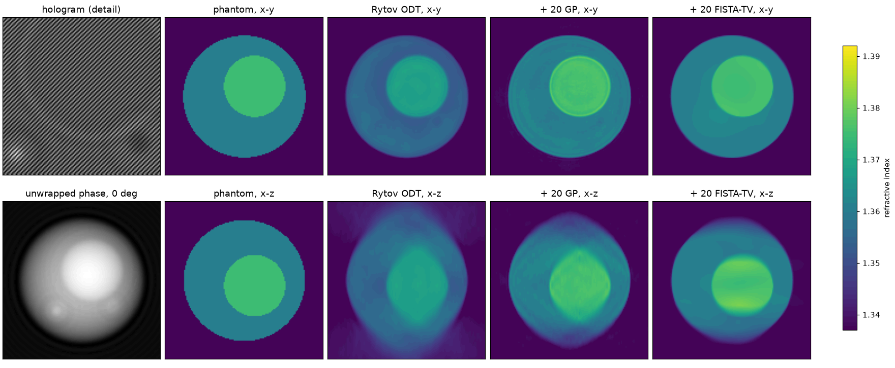
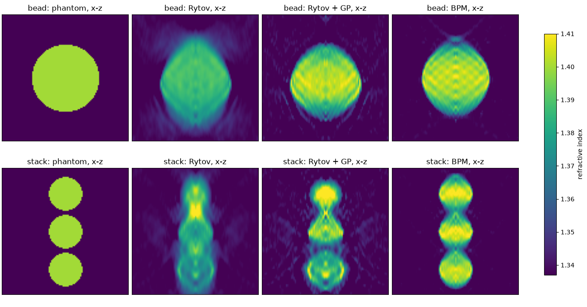

# QoraHolo: refractive-index tomography from off-axis holograms, with missing-cone constraints and multiple-forward-scattering inversion

*Status: draft for physics reading. Software version: QoraHolo 0.1.0, from [pyproject.toml](../pyproject.toml) and [CMakeLists.txt](../CMakeLists.txt). Every numerical value below is taken from a file in this repository, named in the relevant section; nothing was rerun for this paper. Equations restate the repository's model definitions. Reported results are synthetic-data studies and implementation benchmarks, not measurements on a physical specimen.*

## Abstract

Sources: [README.md](../README.md), [docs/ARCHITECTURE.md](ARCHITECTURE.md), and [examples/bpm_figure.py](../examples/bpm_figure.py).

QoraHolo implements optical diffraction tomography from off-axis holograms to a refractive-index volume on CPU and CUDA. The first-order path combines complex-field retrieval, least-squares phase unwrapping, the Rytov approximation and Ewald-sphere mapping, followed optionally by non-negativity or total-variation constraints to fill the missing cone. A beam propagation model (BPM) provides an alternative inversion for multiple forward scattering. On a synthetic cell, whole-volume refractive-index RMSE was 2.37e-3 for direct Rytov reconstruction, 9.25e-4 after Gerchberg-Papoulis (GP), and 7.69e-4 after FISTA-TV, with the TV weight tuned on that phantom. On a noise-free sphere whose fields came from the exact scalar partial-wave solution, BPM reduced RMSE from 4.93e-3 for the best reported first-order reconstruction to 2.50e-3. On noise-free stacked spheres generated with finer-grid BPM, the corresponding errors were 3.89e-3 and 2.00e-3; that comparison tests discretisation and inversion within the BPM approximation. A reusable CUDA pipeline reconstructed a 256³ volume from 49 holograms of 512² pixels in 28 ms with 10 GP iterations using Pipeline::process() with page-locked buffers, excluding initial allocation and background preparation. These results establish synthetic reconstruction accuracy and implementation performance under the stated models; accuracy on measured holograms was not measured.

## 1 Background and question

Source: [README.md](../README.md), especially “Physics conventions” and “What this does not do”; [docs/ARCHITECTURE.md](ARCHITECTURE.md), “Validation”. No additional numerical results are used in this section.

Optical diffraction tomography estimates a transparent sample's refractive index from complex optical fields acquired under different illumination directions. Off-axis holography encodes each field through interference with a tilted reference. Dividing the retrieved sample field by a background field removes the incident illumination, and the Rytov approximation converts the ratio into data suitable for linear diffraction tomography.

Finite numerical aperture leaves an unmeasured region of reciprocal space, the missing cone. Direct inversion therefore elongates structures along the optical axis. Real, non-negative scattering potential and total variation can constrain the missing information, but introduce assumptions about the object. They cannot make a first-order forward model account for multiple scattering.

The project addresses related questions: can the complete hologram-to-index chain recover a known synthetic object; how do missing-cone constraints affect index and shape; does nonlinear forward-scattering inversion improve a case generated by an independent scalar model; and what accuracy and execution cost accompany the CPU and CUDA implementations? The repository does not establish performance on experimental specimens.

## 2 Method

Sources for equations and numerical settings: [README.md](../README.md), [docs/ARCHITECTURE.md](ARCHITECTURE.md), [examples/readme_figure.py](../examples/readme_figure.py), [examples/bpm_figure.py](../examples/bpm_figure.py), and [include/qoraholo/phantom.hpp](../include/qoraholo/phantom.hpp). The absolute noise convention is also defined in [src/phantom.cpp](../src/phantom.cpp).

### Field retrieval and phase

The hologram synthesiser records

$$I(\mathbf r_\perp)=|R(\mathbf r_\perp)+u(\mathbf r_\perp)|^2+\eta,
\qquad R=a\exp(-2\pi i\boldsymbol\nu_c\cdot\mathbf r_\perp).$$

Fourier filtering isolates the sideband containing $uR^*$. All illumination images are cropped around the same reference carrier, preserving their illumination tilt until background division. The field ratio and Rytov field are

$$r=u/u_{\rm bg},\qquad \phi_R=\ln|r|+i\,\operatorname{unwrap}(\arg r).$$

Unwrapping solves the unweighted least-squares problem through a Neumann Poisson equation and a cosine transform. The remaining phase constant is chosen for congruence; the Rytov stage removes the phase multiple determined by the mean image border. This assumes that the border is background. A sample filling the border violates that assumption.

### Diffraction tomography and missing-cone constraints

With time dependence $e^{-i\omega t}$, the scalar model is

$$(\nabla^2+k_m^2)u=-Ou,\qquad O=k_0^2(n^2-n_m^2),\qquad k_0=2\pi/\lambda,\qquad k_m=n_mk_0.$$

Spatial frequencies $\boldsymbol\nu$ are in cycles per length, with Fourier convention $\widehat u(\boldsymbol\nu)=\int u(\mathbf r)e^{-2\pi i\boldsymbol\nu\cdot\mathbf r}\,d\mathbf r$. For the scattered field refocused to the volume centre,

$$\widehat u_s(\nu_x,\nu_y)=\frac{i}{4\pi\nu_z}\widehat O(\boldsymbol\nu-\boldsymbol\nu_{\rm in}),
\qquad \nu_z=\sqrt{(n_m/\lambda)^2-\nu_x^2-\nu_y^2}.$$

Here $\boldsymbol\nu$ lies on the Ewald sphere, and $|\boldsymbol\nu_{\rm in}|=n_m/\lambda$ with a positive z component. The detection pupil restricts lateral frequency to $\mathrm{NA}/\lambda$. In the Rytov approximation, $u_{\rm in}\phi_R$ takes the role of $u_s$. Each illumination samples a shifted Ewald cap. Lateral frequencies already match the volume grid; axial samples are assigned to the nearest bin, with repeated hits averaged. The repository records that the earlier linear-splitting normalisation was incorrect near the cap apex; the reported method uses the corrected nearest-bin mapping.

GP alternates $O\leftarrow\max(\operatorname{Re}O,0)$ in real space and restoration of measured reciprocal-space values. It assumes a non-absorbing sample with $n\geq n_m$. The default implementation uses real transforms and half spectra while accounting for non-Hermitian measured data. Discarding the final imaginary potential remains an output approximation, described in ARCHITECTURE.md.

FISTA-TV instead minimises, for real potential $x$,

$$\frac12\|M(\mathcal F x-P)\|^2+\lambda_{\rm TV}\operatorname{TV}(x),\qquad x\geq0,
\qquad \lambda_{\rm TV}=\texttt{tv\_weight}\,k_0^2.$$

Here $M$ marks measured voxels and $P$ is the mapped spectrum. TV is isotropic, using forward differences; its proximal step uses fast gradient projection on the dual. The reconstructed index is $\operatorname{Re}\sqrt{n_m^2+O/k_0^2}$.

### Multiple forward scattering

BPM propagates the envelope $w=u/u_{\rm in}$ through a phase screen per voxel slice of thickness $d$. For slice index $j$,

$$A_j=\mathcal F_\perp\!\left[e^{ik_0d(n_j-n_m)}w_j\right],\qquad
S_{j+1}=c\,[qA_j+(1-q)S_j],\qquad w_j=\mathcal F_\perp^{-1}S_j,$$

$$c=e^{2\pi i(\nu_z-\nu_{{\rm in},z})d},\qquad q=(n_m/\lambda)/\nu_z.$$

Here $\nu_z=\nu_z(\boldsymbol\mu+\boldsymbol\nu_{\rm in})$, with $\boldsymbol\mu$ the envelope bin: $c$ and $q$ are evaluated at the field frequency $\boldsymbol\mu+\boldsymbol\nu_{\rm in}$. The propagator sets $c=0$ for $|\boldsymbol\mu+\boldsymbol\nu_{\rm in}|\geq n_m/\lambda$; $q$ is capped at the detection-pupil edge. After propagation, fields are refocused to the volume centre and pupil filtered. The obliquity weight $q$ restores the first-Born weak-object limit; the plain phase-screen variant sets $q=1$ and is an ablation, not the default model used for the main results.

Inversion minimises the mean squared complex-field discrepancy over illuminations, with $n\geq n_m$ and optional TV on index contrast. Reverse propagation of stored envelopes gives the gradient. Full-angle steps use FISTA momentum; the example starts from Rytov plus 20 GP iterations and performs 30 BPM iterations. The model has periodic lateral boundaries and excludes reflections.

### Synthetic objects and evaluation

The cell example uses wavelength 0.532 µm, medium index 1.337, detection NA 1.2, and 49 illuminations at illumination NA 0.9. The body, nucleus and vesicles have indices 1.360, 1.375 and 1.390. Holograms are 512² pixels, cropped to 256² fields on a 0.11 µm grid, yielding a 256³ volume. Fields come from the analytic-sphere Rytov construction, not a full-wave cell solution. The scripts specify additive Gaussian noise with standard deviation 0.02 in intensity units for both sample and background. With reference amplitude $a=1$ and $|u|\approx1$, the mean intensity is approximately 2, so this is consistent with the README's 1% of mean intensity. Sample and background seeds are 1 and 2.

The stronger-scattering examples use 128³ voxels at 0.15 µm, the same wavelength, medium and numerical apertures, and no noise. The bead has radius 4 µm and index 1.400; its fields come from an exact scalar partial-wave solution. The stack contains spheres of radius 2 µm at axial positions −4.5, 0 and 4.5 µm, generated by BPM at 0.075 µm and Fourier cropped to the inversion grid. That avoids identical discretisations but retains the same physics approximation.

RMSE is the square root of the mean squared index difference from the rendered phantom over the entire volume, as defined in the example scripts. Thus background voxels contribute to the score. Interior means use the inner 0.6 of the sphere radius; the cell script uses this mask for its nucleus. No experimental uncertainty or resolution estimate is provided.

## 3 Results

### Synthetic cell: missing-cone filling

Sources: [README.md](../README.md), opening figure description; [examples/readme_figure.py](../examples/readme_figure.py) for masks and settings.

| Reconstruction | Whole-volume RMSE | Mean nucleus index |
|---|---:|---:|
| Rytov ODT | 2.37e-3 | 1.3683 |
| Rytov + 20 GP iterations | 9.25e-4 | 1.3757 |
| Rytov + 20 FISTA-TV outer iterations, 10 dual steps | 7.69e-4 | 1.3762 |
| Ground truth | — | 1.3750 |

The largest illumination-frequency estimation error from background sidebands was 4.3e-6 cycles/µm. GP reduces axial elongation; TV reduces remaining elongation and ringing but overshoots at the top and bottom of the nucleus along the optical axis. The TV weight, 1e-2, was selected on this phantom, so this is a tuned comparison.

*Existing repository figure from examples/readme_figure.py. It shows the phantom, direct Rytov, GP and TV reconstructions; the numerical table follows its README description.*

The README solver benchmark (bench/bench.cpp) uses a different input: noise sigma = 0.01 instead of 0.02, the true illuminations instead of estimated ones, a known carrier instead of one estimated from background holograms, and one shared seed (1) instead of seeds 1 and 2. Its GP RMSE of 9.21e-4 is therefore a separate condition, not a replicate. The contribution of these input differences to the gap from 9.25e-4 was not measured.

### Stronger scattering: exact bead and finer-grid stack

Sources: [README.md](../README.md), “Multiple scattering: beam propagation”; [examples/bpm_figure.py](../examples/bpm_figure.py). Interior means use the mask defined in Method; true index is 1.400.

| Reconstruction | Exact bead RMSE | Bead interior mean | Stack RMSE | Stack interior mean |
|---|---:|---:|---:|---:|
| Rytov ODT | 6.87e-3 | 1.3882 | 4.94e-3 | 1.3807 |
| Rytov + 20 GP | 5.36e-3 | 1.4016 | 4.27e-3 | 1.3964 |
| Rytov + 20 FISTA-TV | 4.93e-3 | 1.4009 | 3.89e-3 | 1.3990 |
| BPM, 30 iterations from Rytov + GP | 2.50e-3 | 1.4019 | 2.00e-3 | 1.4031 |
| BPM + TV, weight 3e-2 | 2.39e-3 | 1.4018 | 1.95e-3 | 1.4032 |
| BPM with plain phase screen | 5.06e-3 | 1.4279 | 3.64e-3 | 1.4268 |

*Existing repository figure from examples/bpm_figure.py. Columns show truth, Rytov, Rytov plus GP, and obliquity-weighted BPM inversion.*

The first-order constraints improve mean index without fully restoring shape. BPM improves whole-volume RMSE and separates the stacked spheres, while axial elongation remains. Its TV weight was selected from a coarse bead sweep from 1e-4 to 1e-1 at 64³ and gives only a modest further improvement in these reported cases. The plain-screen stack row additionally has a model mismatch because the synthetic stack data include the obliquity weight. The exact-bead row does not share that construction mismatch.

For unregularised BPM, reported CUDA times were 0.52 s for the bead and 0.53 s for the stack; CPU times were 23.7 s for each. These are single-run timings, exclude the Rytov-plus-GP initialisation, and have no named hardware for these example runs. The repository states that CPU and CUDA results agree to the printed digits. Repeated-run accuracy distributions and uncertainty bars were not measured in these examples.

### Implementation agreement and execution cost

Sources: [README.md](../README.md), “Benchmark”; [docs/ARCHITECTURE.md](ARCHITECTURE.md); [docs/tv_kernels.md](tv_kernels.md).

The benchmark environment was an AMD Ryzen 5 7500F with 6 cores and an NVIDIA GeForce RTX 5070 with 12 GB, Windows 11, MSVC 19.44, CUDA 13.4 and driver 610.88. The following sample-hologram-to-index times use 49 illuminations and 10 GP iterations, with medians of 5 runs at 256³ and 3 at 512³. Background setup is outside the repeated pipeline calls.

| Execution path | 256³ CPU (ms) | 256³ CUDA (ms) | 512³ CUDA (ms) |
|---|---:|---:|---:|
| Per-call functions | 1071 | 82 | 440 |
| Pipeline run, copying input/output buffers | 1022 | 40 | 329 |
| Pipeline process, page-locked buffers | 974 | 28 | 221 |
| Constructor, once | 3.78 | 20 | 68 |
| Background setup, once | 61 | 5.22 | 41 |

Pipeline device memory was 0.42 GiB at 256³ and 2.39 GiB at 512³. The 512³ CPU case was not measured. At 256³, relative CPU/CUDA index-contrast differences were 3.8e-6 for per-call reconstruction and 3.9e-6 through Pipeline. At 512³, reported comparisons are between CUDA variants, not against CPU.

The missing-cone loop dominates the CUDA pipeline: 20 ms at 256³ and 177 ms at 512³ for its GP iterations and final inverse transform. The TV study reduced the dual-step time from 2.131 to 1.618 ms at 256³ by kernel fusion, with unchanged output bit for bit. Shared-memory tiling did not improve this result. Counters show the fused kernel moving 12.7 real-volume equivalents and reaching 84.3% of DRAM peak at 256³. A 512³ counter profile was not obtained because profiler replay exhausted host memory; its reported timings are event measurements.

ARCHITECTURE.md reports an adjoint-identity discrepancy of 2.7e-6 and a tangent-linear versus finite-difference discrepancy of 1.8e-4 for BPM. These are stored implementation checks, not experimental error estimates. No tests were rerun for this summary.

## 4 Discussion

Sources: [README.md](../README.md) and [docs/ARCHITECTURE.md](ARCHITECTURE.md). Numerical observations referred to here are those reported in Results; no new numerical estimates are introduced.

The synthetic cell demonstrates that the complete field-retrieval and first-order inversion chain is internally consistent with its analytic forward construction. It also shows that missing-cone constraints can improve index accuracy without adding illumination angles. Because generation and inversion share the first-order scattering model, this does not validate that approximation for a real cell.

The exact bead provides a stronger physical check: data are generated by a scalar Helmholtz solution rather than by the BPM being inverted. Its lower BPM error supports the usefulness of multiple-forward-scattering inversion for that object. The stack shows, for this configuration, that the improvement survives a change in spatial discretisation. It retains an inverse-crime caveat because data generation and inversion use the same obliquity-weighted BPM, and cannot establish BPM accuracy against an independent multiple-scattering solution.

Obliquity matters to the model, not just to numerical optimisation. The repository's corrected weak-object limit and the plain-screen ablation support retaining the weighted scattered contribution at tilted illumination. They do not establish a general nonparaxial full-wave solver: backscattering, vector effects and lateral boundary errors remain outside the validation.

A restored mean index is insufficient evidence of a correct shape. Similarly, agreement between CPU and CUDA demonstrates implementation consistency, not physical correctness. The performance results show the value of persistent plans, resident background fields and reduced transfers for repeated reconstructions on the measured hardware; they are not a hardware-independent throughput claim.

## 5 Limitations and open questions

Sources: [README.md](../README.md), “What this does not do” and benchmark qualifications; [docs/ARCHITECTURE.md](ARCHITECTURE.md), “Validation” and “Beam propagation”; both example scripts named in Method. No additional numerical claims are introduced here.

- **Experimental validation is absent.** Accuracy, stability and resolution on measured holograms were not measured. Aberration, pupil correction, automatic refocusing and instrument integration are not implemented.
- **Forward-model scope is restricted.** The cell uses analytic first-order sphere fields. The exact comparison is for a homogeneous scalar sphere. The stack uses the same BPM physics at finer resolution. Reflection and vector scattering are not modelled; BPM boundaries are periodic.
- **Missing data remain missing.** GP and TV impose non-absorption and non-negative contrast. Samples violating these assumptions are outside the demonstrated scope. BPM retains the illumination-limited missing cone.
- **Regularisation is tuned.** Cell and BPM TV weights were selected using the demonstration phantoms. Transfer to unknown samples and automatic parameter selection were not measured. More iterations do not necessarily improve phantom RMSE, as the README solver sweep shows.
- **Metrics have limited coverage.** Whole-volume RMSE includes background and is not an object-only shape or resolution metric. Interior means omit boundary regions. Experimental uncertainty, noise-ensemble variability and generalisation across biological structures were not measured.
- **Phase conventions require calibration.** The unwrapping border must be background, and the selected sideband fixes field conjugation. Sensitivity to experimental failures of these assumptions was not measured.
- **Reported values are summaries.** The figure-description and solver-benchmark GP errors use different input conditions as stated in Results; the contribution of those differences to the RMSE gap was not measured. The repository contains no raw run logs. The explicit gridding correction and weighted-BPM convention in the current documents take precedence over their superseded alternatives.
- **Performance scope is narrow.** Measurements concern the stated CPU/GPU environment. Larger-volume CPU comparison and larger-volume profiler counters are absent. BPM adjoint-kernel counters were outside the profiled launch window and were not measured.

## 6 Next steps

Basis: the gaps documented in [README.md](../README.md) and [docs/ARCHITECTURE.md](ARCHITECTURE.md). These are proposed follow-up experiments, not completed results; no numerical target is asserted.

- Validate on measured sample and background holograms with independently calibrated illumination, pupil and focus, and a reference specimen of known index and geometry.
- Compare BPM with an independent multiple-scattering forward solution for nonspherical or interacting objects; separate model error from discretisation and optimisation error.
- Report object-region errors, axial and lateral resolution, noise-realisation variability, and sensitivity to phase-border and sideband choices alongside whole-volume RMSE.
- Evaluate TV selection on objects excluded from parameter tuning, and document how iteration stopping affects shape and index.
- Preserve run-specific result files and input conditions for each GP result before using it as a reproducibility reference; compare matched inputs to assess the RMSE gap. Extend hardware comparisons and memory measurements where resources permit.

## References

Bibliographic details below are reproduced from [README.md](../README.md); external literature was not independently checked for this summary.

- E. Wolf, “Three-dimensional structure determination of semi-transparent objects from holographic data,” *Opt. Commun.* **1**, 153 (1969).
- A. C. Kak and M. Slaney, *Principles of Computerized Tomographic Imaging*, IEEE Press (1988), ch. 6.
- A. J. Devaney, “Inverse-scattering theory within the Rytov approximation,” *Opt. Lett.* **6**, 374 (1981).
- Y. Sung et al., “Optical diffraction tomography for high resolution live cell imaging,” *Opt. Express* **17**, 266 (2009).
- E. Cuche, P. Marquet and C. Depeursinge, “Spatial filtering for zero-order and twin-image elimination in digital off-axis holography,” *Appl. Opt.* **39**, 4070 (2000).
- D. C. Ghiglia and L. A. Romero, “Robust two-dimensional weighted and unweighted phase unwrapping that uses fast transforms and iterative methods,” *J. Opt. Soc. Am. A* **11**, 107 (1994).
- R. W. Gerchberg, “Super-resolution through error energy reduction,” *Opt. Acta* **21**, 709 (1974); A. Papoulis, “A new algorithm in spectral analysis and band-limited extrapolation,” *IEEE Trans. Circuits Syst.* **22**, 735 (1975).
- K. Lim et al., “Comparative study of iterative reconstruction algorithms for missing cone problems in optical diffraction tomography,” *Opt. Express* **23**, 16933 (2015).
- A. Beck and M. Teboulle, “A fast iterative shrinkage-thresholding algorithm for linear inverse problems,” *SIAM J. Imaging Sci.* **2**, 183 (2009); “Fast gradient-based algorithms for constrained total variation image denoising and deblurring problems,” *IEEE Trans. Image Process.* **18**, 2419 (2009).
- L. I. Rudin, S. Osher and E. Fatemi, “Nonlinear total variation based noise removal algorithms,” *Physica D* **60**, 259 (1992).
- M. D. Feit and J. A. Fleck, “Light propagation in graded-index optical fibers,” *Appl. Opt.* **17**, 3990 (1978).
- U. S. Kamilov et al., “Learning approach to optical tomography,” *Optica* **2**, 517 (2015); “Optical tomographic image reconstruction based on beam propagation and sparse regularization,” *IEEE Trans. Comput. Imaging* **2**, 59 (2016).
- J. Lim et al., “High-fidelity optical diffraction tomography of multiple scattering samples,” *Light Sci. Appl.* **8**, 82 (2019).
- C. F. Bohren and D. R. Huffman, *Absorption and Scattering of Light by Small Particles*, Wiley (1983), ch. 4. This is the vector-sphere reference; QoraHolo uses the scalar analogue.
