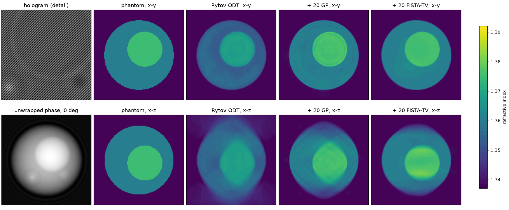

# QoraHolo

QoraHolo reconstructs the 3D refractive index of a transparent sample from off-axis holograms
recorded under many illumination angles (holotomography, or optical diffraction tomography,
ODT). It runs the standard pipeline: field retrieval from the hologram sideband, phase
unwrapping, the Rytov approximation, Ewald-sphere mapping by the Fourier diffraction theorem,
and a missing-cone solver (Gerchberg-Papoulis with non-negativity, or FISTA with total
variation). Where first-order models break down, in large, high-contrast or stacked objects, a
multi-slice beam propagation model (BPM) and its gradient-based inversion account for multiple
forward scattering.

It is written in C++20 with a CPU backend (pocketfft, OpenMP) and a CUDA backend (cuFFT and
custom kernels) for every stage, and Python bindings that take and return numpy arrays. A
sphere phantom with an analytic (and, for one sphere, exact) forward model and a hologram
synthesiser make the whole chain testable against a known answer.



## Requirements

- CMake 3.28 or later and Ninja (the CMake presets use it).
- A C++20 compiler: gcc 13 or later, or MSVC 2022.
- For the CUDA backend, the CUDA Toolkit 12.8 or later. The GPU architecture defaults to the
  one in the build machine (`CMAKE_CUDA_ARCHITECTURES=native`).
- For the Python package, Python 3.12 or later and numpy 2.

## Install

QoraHolo is not on PyPI. The Python package is built from a clone:

```sh
git clone https://github.com/NaNIsaac/QoraHolo
cd QoraHolo
uv venv
uv pip install .                                        # CPU only
uv pip install . -C cmake.define.QORAHOLO_CUDA=ON       # with the CUDA backend
```

The README's [Quick start](../README.md#quick-start) builds a wheel with `uv build --wheel`
instead, and builds the C++ library, tests and examples with the CMake presets.

The CUDA build needs the CUDA Toolkit and the compiler on the path of the shell that runs it; on
Windows, that is a shell where `vcvars64.bat` has run and `nvcc` is found. On Windows,
scikit-build-core configures with the Visual Studio generator unless told otherwise, and that
generator finds CUDA only through the toolkit's Visual Studio integration; with a toolkit
installed without it (from conda-forge, for example), set the generator to Ninja first:

```bat
set CMAKE_GENERATOR=Ninja
uv pip install . -C cmake.define.QORAHOLO_CUDA=ON
```

At import, `qoraholo` adds `%CUDA_PATH%\bin` to the DLL search path, so cuFFT is found when
`CUDA_PATH` is set.

## First run

This simulates a measurement and reconstructs it: a bead of index 1.360 in a medium of 1.337,
49 illuminations at NA 0.9, holograms with 1% noise and their backgrounds, then sideband
extraction, field ratio, Rytov, and Gerchberg-Papoulis into a 64³ volume.

```python
import numpy as np
import qoraholo as qh

N = 64  # field and volume side; holograms are 2N
holo_geom = qh.Geometry(wavelength=0.532, n_medium=1.337, na=1.2, pixel=0.055)  # camera, um
geom = qh.Geometry(wavelength=0.532, n_medium=1.337, na=1.2, pixel=0.11)  # field and voxel
bead = [qh.Sphere(z=0.0, y=0.0, x=0.0, radius=2.0, n=1.360)]

# Simulated measurement: 49 tilted plane waves through the bead, and the same without it
illum = qh.circular_scan(49, 0.9, geom)
ratio = qh.forward_fields(bead, illum, holo_geom, 2 * N)
holograms = qh.synthesize_holograms(ratio, illum, holo_geom, noise=0.01, seed=1)
backgrounds = qh.synthesize_holograms(np.ones_like(ratio), illum, holo_geom, noise=0.01, seed=2)

backend = "cuda" if qh.cuda_available() else "cpu"
carrier = qh.find_sideband(backgrounds[0])  # reference carrier, pixels from DC
df = 1.0 / (2 * N * holo_geom.pixel)  # hologram frequency step, cycles/um
opts = dict(
    center=(carrier.iy, carrier.ix),
    radius=np.ceil(holo_geom.na / holo_geom.wavelength / df) + 1,
    output_size=N,
    backend=backend,
)
fields = qh.field_ratio(qh.extract_fields(holograms, **opts), qh.extract_fields(backgrounds, **opts))
ri = qh.reconstruct(qh.rytov(fields, backend=backend), illum, geom, iterations=20, backend=backend)

truth = qh.render_phantom(bead, geom, N, N)
inside = truth > geom.n_medium
print(f"{backend}: volume {ri.shape}, mean n inside the bead {ri[inside].mean():.4f} (true 1.3600)")
print(f"RMSE against the phantom {np.sqrt(np.mean((ri - truth) ** 2)):.2e}")
```

Output from a CUDA build of this commit (Windows 11, Python 3.13, CUDA 13.4, RTX 5070):

```
cuda: volume (64, 64, 64), mean n inside the bead 1.3592 (true 1.3600)
RMSE against the phantom 1.89e-03
```

A CPU-only build prints the same two numbers with `cpu:`. Without `iterations=20`, that is plain
Rytov ODT with no missing-cone solver, the same data give 1.3558 inside the bead and an RMSE of
3.24e-3. The README's opening figure shows the same comparison on a synthetic cell in x-z
slices, where the missing cone is visible as elongation along z.

A CUDA build cannot be imported at all unless the cuFFT DLL can be found: without `CUDA_PATH`
(or the toolkit's `bin` on the DLL search path) `import qoraholo` fails with
`DLL load failed while importing _core`.

## Where to go next

The README is the full user guide:

- [Quick start](../README.md#quick-start): the C++ API, and `Pipeline`, which keeps plans and buffers between calls for a time series.
- [Multiple scattering: beam propagation](../README.md#multiple-scattering-beam-propagation): when Rytov and Born fail, `bpm_reconstruct`, and how it compares on a large bead and on stacked beads.
- [First Born operator in 2D](../README.md#first-born-operator-in-2d): `qoraholo.born2d`, an explicit linear operator with its adjoint for small inverse problems.
- [Array conventions](../README.md#array-conventions) and [Physics conventions](../README.md#physics-conventions): layout, units (cycles/µm, not rad/µm), the scattering potential, the Fourier diffraction theorem as used here, Rytov, gridding, the missing-cone solvers, BPM, the exact sphere, holograms and unwrapping.
- [Benchmark](../README.md#benchmark), [What this does not do](../README.md#what-this-does-not-do) and [References](../README.md#references).

On this site:

- [Architecture](ARCHITECTURE.md): the data flow, centre-origin bookkeeping, how each stage runs on the GPU, memory, and how the stages are validated.
- [TV solver on the GPU](tv_kernels.md): how the fast gradient projection step of the TV solver was made faster, with Nsight Compute counters.
- The Python API page lists the public functions and classes of the `qoraholo` package with their docstrings.
